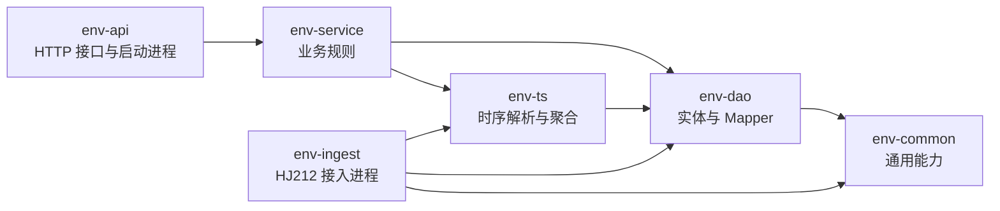
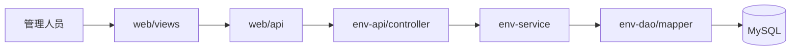
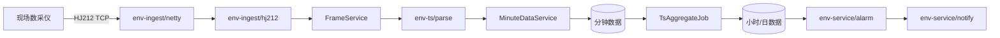

# 代码目录解析

## 1. 项目定位

这是一个“污染源自动监控设施第三方运维信息管理系统”。系统同时处理两类核心业务：

1. 数采仪通过 HJ212 协议上报监测数据，平台完成拆包、校验、解析、落库、聚合和报警。
2. 管理人员通过 Web 端管理站房、报警、消息通知和第三方运维证据链。

当前正式技术路线是 **Vue3 管理端 + Java/Spring Boot 多模块后端**。`server/` 中的 NestJS 代码是早期参考实现，不再作为新增功能的主开发目录。

## 2. 顶层目录功能表

| 目录 | 定位 | 主要内容 | 是否是主代码 |
|---|---|---|---|
| `backend/` | 正式 Java 服务端 | Spring Boot 2.7.18、JDK 8、MyBatis-Plus、Sa-Token；分为 6 个 Maven 模块 | 是 |
| `web/` | Web 管理端 | Vue3、Vite、Element Plus、Pinia、Axios、ECharts | 是 |
| `server/` | NestJS 参考实现 | 早期验证的认证、站房、监测、HJ212 接入等逻辑 | 否，仅供对照 |
| `deploy/` | 本地基础设施 | Docker Compose 启动 MySQL、Redis，可选 TDengine | 配套目录 |
| `docs/` | 产品与技术文档 | 需求、架构决策、数据库设计、HJ212 接入、报警推送、页面清单和架构图 | 设计依据 |

## 3. 正式后端 `backend/`

### 3.1 模块依赖关系

`env-api` 和 `env-ingest` 是两个独立启动的进程：前者面向浏览器和管理接口，后者面向现场数采仪 TCP 连接。

### 3.2 各模块职责

| 模块 | 功能 | 重点子目录或类 |
|---|---|---|
| `env-common/` | 全系统公共基础能力 | `api/` 统一响应与分页；`exception/` 业务异常；`context/` 租户上下文；`audit/` 审计注解与切面；`web/` traceId 和响应包装 |
| `env-dao/` | 数据访问和数据库结构 | `entity/` 数据实体；`mapper/` MyBatis-Plus Mapper 和聚合 SQL；`dto/` 查询结果对象；`config/` 多租户与自动填充；`db/migration/` Flyway 建表及升级脚本 |
| `env-ts/` | 时序数据处理 | `parse/` 解析 HJ212 CP 数据；`calc/` 有效性、超量程和聚合规则；`service/` 分钟落库、小时/日聚合、查询与重算；`job/` 定时聚合任务；`dto/` 实时值与有效率输出 |
| `env-service/` | 核心业务层 | 根目录负责登录、站房、监控和系统用户；`alarm/` 报警检测与事件闭环；`notify/` 模板、接收人、渠道、升级与重试；`ops/` 计划、任务、打卡、记录、审核和证据链核验 |
| `env-api/` | HTTP 接口层 | `controller/` 暴露认证、站房、监控、报警、消息、运维、系统接口；`config/` Sa-Token、角色、租户上下文和异常处理；`EnvApiApplication` 启动 Web 服务及定时任务 |
| `env-ingest/` | HJ212 独立接入层 | `hj212/` CRC、帧编解码、拆包、SM4 工具；`netty/` TCP 服务与连接处理；`service/FrameService` 校验 MN、保存原始帧并写入分钟数据 |

### 3.3 后端业务包

| 业务包 | 负责的业务 |
|---|---|
| `service/alarm/` | 超标、恒值、缺数检测；事件去重、恢复、处置和定时扫描 |
| `service/notify/` | 飞书、短信、小程序、站内消息；模板渲染、接收人路由、失败降级、T+15/T+30 升级 |
| `service/ops/` | 月度计划、任务状态机、300 米电子围栏、现场记录、审核、报警转工单和标记核验 |
| `ts/parse/` | 将 HJ212 报文中的 CP 数据转换为站房、因子、时间、数值和标记 |
| `ts/calc/` | 小时至少 45 个有效分钟、日值至少 75% 有效小时等附录 G 规则 |
| `dao/entity/` | 站房、设备、用户、报警、消息、工单和时序数据的数据库对象 |
| `dao/mapper/` | CRUD、最新值、统计、聚合、幂等 upsert 等 SQL 入口 |

## 4. 管理端 `web/`

| 目录或文件 | 功能 |
|---|---|
| `src/views/` | 页面组件：登录、工作台、站房列表、运维证据链 |
| `src/layouts/` | 登录后的主框架，包括侧栏、顶部区域和内容容器 |
| `src/router/` | 路由定义、登录拦截、页面标题和角色元数据 |
| `src/api/` | Axios 请求封装，以及认证、站房、监控、报警、消息和运维接口定义 |
| `src/stores/` | Pinia 状态；当前主要保存登录用户、角色和 token 状态 |
| `src/styles/` | 全局样式和页面视觉规范 |
| `src/main.ts` | 前端启动入口，挂载 Vue、Pinia、路由和 Element Plus |
| `src/App.vue` | 根组件，承载路由出口 |

当前前端已经暴露 4 个主要页面：`/login`、`/dashboard`、`/stations`、`/ops`。后端接口能力比现有页面更多，报警详情、消息日志、系统用户等功能仍可继续补页面。

## 5. 参考服务 `server/`

| 目录 | 功能 |
|---|---|
| `src/modules/auth/` | JWT 登录和身份认证 |
| `src/modules/station/` | 站房查询、新建和状态变更 |
| `src/modules/ingest/` | HJ212 HTTP/TCP 接入、CRC 和编解码 |
| `src/modules/monitor/` | 工作台统计和监控查询 |
| `src/modules/system/` | 系统管理模块骨架 |
| `src/common/` | 守卫、拦截器、异常、请求上下文和审计 |
| `src/database/` | TypeORM 实体和演示数据初始化 |
| `test/` | HJ212 编解码与拆包测试 |

该目录能帮助理解早期设计，但正式代码已迁移到 `backend/`。修复和新增业务应优先修改 Java 模块，避免两套后端继续分叉。

## 6. 文档与部署目录

### `docs/`

| 文件 | 内容 |
|---|---|
| `00-架构决策记录.html` | Java/JDK 8、数据库和部署等关键选型 |
| `01-需求规格说明书.html` | 业务范围、角色和验收需求 |
| `02-数据库设计.html`、`schema.sql` | 数据模型和完整 DDL |
| `03-HJ212-2025接入方案.html` | 接入协议、命令、拆包、应答和测试要求 |
| `04-报警与推送设计.html` | 报警规则、渠道、升级和失败处理 |
| `05-页面清单与交互说明.html` | 管理端和移动端页面规划 |
| `diagrams/` | 架构图、流程图及其 JSON 源文件 |

### `deploy/`

`docker-compose.yml` 定义：

- MySQL 8：业务数据、报警、工单和当前时序表。
- Redis 7：计划用于缓存、会话、幂等和限流。
- TDengine 3：可选 profile，后续用于大规模分钟、小时和日时序数据。

## 7. 两条关键调用链

### 管理端请求

### 监测数据接入

## 8. 阅读代码的建议顺序

1. 看根目录 `README.md`，确认项目目标、已实现功能和已知限制。
2. 看 `web/src/router/index.ts`，从用户能看到的页面建立功能地图。
3. 看 `env-api/controller/`，确认每项功能的 HTTP 入口。
4. 沿控制器进入 `env-service/`，阅读真实业务规则。
5. 数据计算问题进入 `env-ts/`，数据表和 SQL 问题进入 `env-dao/`。
6. 设备接入问题从 `env-ingest/netty/Hj212Server` 和 `Hj212ChannelHandler` 开始。

## 9. 可忽略的生成目录

| 目录 | 含义 |
|---|---|
| `backend/*/target/` | Maven 编译产物、测试报告和 JAR，不是手写源码 |
| `server/dist/` | NestJS 编译后的 JavaScript，不应直接修改 |
| `web/node_modules/`、`server/node_modules/` | npm 依赖包，不属于项目业务代码 |
| `backend/.tools/` | 项目自带的 Maven 工具，用于本机环境兼容 |

